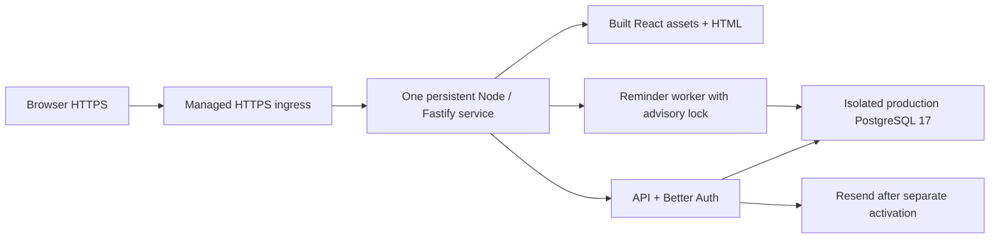

# BudoGraph — Deployment D1

Дата: **18 октомври 2026 г.** База: `main`,
`1972da19bbf0f2f008d4cf10f3137deb954b2508`.
**D1 SOURCE IMPLEMENTATION: COMPLETE. D1 HUMAN PASS — 8/8, owner-confirmed.**
**D1 HUMAN ACCEPTANCE: PASS 8/8 — DOCUMENTED. PRODUCTION SECURITY GATES: PARTIAL.**
Това е repository-side основа с локална репетиция, а не разрешение за live release.
След личния преглед собственикът изрично разреши само D1 Git commit и нормален
push в частното хранилище. Няма public deployment, покупка, DNS промяна или реален
email. D2 и Calendar C1 integration не са започнати.
Вътрешната цел **30 ноември 2026** не е официален срок на НОИТ.

## 1. Проверена архитектура и обхват

- React 19 / Vite 6.4.3 изгражда `dist/`. Клиентът използва относителни `/api`
  адреси и History API. Няма нужда от production Vite proxy или Vite процес.
- Fastify 5.12.5 е постоянен Node процес. TypeScript компилира backend и CLI в
  `server/dist/`; правилният release entry point е `server/dist/src/production.js`,
  който допуска само `NODE_ENV=production` и зарежда компилирания `main.js`.
- D1 добавя същия origin за HTML, assets, `/api` и `/api/auth`. Един Node service
  обслужва frontend и backend. Публичният HTTPS terminator е отговорност на хоста.
- PostgreSQL 17, `pg` 8.23.1: max 10 връзки на процес, 5 s connect timeout,
  30 s idle timeout. Отделната worker lock връзка е част от тези 10, не нов pool.
- Better Auth 1.7.7 пази акаунти/сесии в PostgreSQL; cookie cache е изключен.
  Production изисква проверен email, Secure + HttpOnly + SameSite=Lax cookies.
  При липса на override библиотеката използва 7-дневна сесия и 24-часов updateAge;
  проверено в инсталирания код, не променяно в D1.
- Публичният `/sign-up/email` остава забранен. Само валидна Event покана може
  да извика private registration instance; присъединяването е отделно и изрично.
- Task/Change/Event правата, personal-template owner isolation, optimistic
  concurrency, history и durable receipts са съществуващи услуги. Не са заменяни.
- Resend използва native server-side `fetch`, 10 s timeout, без SDK. Приет от
  provider request не доказва получено писмо. Auth email tasks са в паметта.
- Reminder worker работи през 30 s след приключил проход, с bound 100 кандидата.
  Съществуващите транзакции/unique notification constraint пазят deduplication.
- Startup не изпълнява миграции. D1 production startup само чете metadata и
  проверява всички файлови checksums и липсата на pending миграции, преди listen.
- `/api/health/live` не проверява DB; `/api/health/ready` изпълнява `SELECT 1`
  с timeout и връща само `ok`/`unavailable`, без SQL, URL или credentials.
- SIGINT/SIGTERM затварят HTTP, изчакват worker/email задачи, после затварят pool.
  Идемпотентният shutdown и idle production shutdown са проверени. Продължителен
  worker pass/заявка може да надхвърли grace period на хоста; load drain е P1 gate.
- Няма съществуваща `.github/workflows` CI конфигурация. D1 не добавя автоматично
  публикуване. Командите по-долу са задължителен ръчен release gate.



DB връзката е **verify-full**: доверен PEM CA, hostname verification,
`rejectUnauthorized=true`, минимум TLS 1.2. URL query overrides и
`NODE_TLS_REJECT_UNAUTHORIZED=0` са забранени. Използвайте direct или **session**
pooler; transaction pooling е несъвместим със session advisory locks на migration
runner и D1 worker. Това съответства на [Supabase connection guidance](https://supabase.com/docs/guides/database/connecting-to-postgres).

## 2. Реализирано в D1

| Промяна                                               | Доказателство и граница                                                                                                                                                                                                    |
| ----------------------------------------------------- | -------------------------------------------------------------------------------------------------------------------------------------------------------------------------------------------------------------------------- |
| Bounded exact build inventory, Node/Fastify built-ins | Без нов dependency/glob. До 1024 файла / 32 MiB общо, 5 MiB за файл, depth 8; само допуснати MIME типове, без symlinks/dotfiles/sourcemaps/API routes. Request input никога не става filesystem path.                      |
| SPA fallback                                          | GET/HEAD с `Accept: text/html`; `/events/:id/templates`, `/invite/:token`, login/reset и другите extensionless маршрути. Query string се запазва в browser URL.                                                            |
| API separation                                        | `/api`, `/api/*`, липсващи assets, dotfiles, sourcemaps, encoded/backslash fallback probes не стават HTML. POST към SPA връща 404.                                                                                         |
| Cache                                                 | HTML и всички API успехи/грешки са `no-store`; API също `Pragma: no-cache`/`Expires: 0`. Само fingerprinted `assets/*` получават 1 year immutable.                                                                         |
| Headers                                               | CSP с hash за съществуващия inline preference script; scripts/connect само self, object/base/frame restrictions; nosniff, DENY, no-referrer, ограничени permissions. Production HSTS 1 year без preload/includeSubDomains. |
| Proxy trust                                           | Празен allowlist по подразбиране. Само до 16 точни IP адреса; няма `true`, hop count, wildcard или широк CIDR. Fastify избира най-близкия недоверен hop.                                                                   |
| Auth forwarding                                       | Host идва от server origin; `Forwarded`, X-Forwarded-* и X-Real-IP се премахват преди Better Auth; неговият private client-IP header се заменя с проверения `request.ip`.                                                  |
| Abuse boundaries                                      | Global body limit 64 KiB; auth остава 4 KiB. Request receive timeout 30 s и socket timeout 10 s; това не е пълен execution timeout или DDoS защита.                                                                        |
| Worker concurrency                                    | Пинната session advisory lock връзка изключва едновременни проходи; конкуриращият се worker пропуска текущия проход и опитва отново по нормалния график. Durable dedupe е запазен.                                         |
| Production settings                                   | Строги boolean flags; production забранява изключен frontend и `WEB_CONCURRENCY`, различен от `1`. Provider replica count все пак се задава отделно.                                                                       |
| Release build/start                                   | Без автоматично четене на development env. Build subprocesses получават само OS/tool environment. Root `.env*` и `VITE_*` водят до отказ на release build.                                                                 |
| Provenance                                            | `server/dist/release.json`: base commit, dirty flag, SHA-256 на конкретните source/build inputs, Node и pnpm версия. Няма secret values.                                                                                   |
| Native hosting recipe                                 | `render.yaml`: един paid Frankfurt service, manual deploy, health path, точно pinned Node 24.16.0 и runtime secrets, подавани отделно. Не е прилаган към акаунт.                                                           |
| Тестова поправка                                      | Schema integration test още очакваше само 0001–0010. Обновен е до реалните 0001–0013 и no-op count 13; SQL файловете не са променяни.                                                                                      |

Inline styles остават позволени за съществуващия React UI. CSP не е твърдение
за пълна XSS защита. Static root трябва да е неизменимият `dist/`, собственост на
release build, без runtime uploads/secrets/symlinks. Няма frontend/CSS промяна.

Production dependency audit първоначално откри три brace-expansion advisories в
разгледания static-plugin glob chain ([advisory](https://github.com/advisories/GHSA-q2hr-2g5m-vwhr)).
Посочената поправена версия не беше достъпна за инсталиране. Plugin-ът и
неработещият version override са премахнати; окончателната реализация използва
Node built-ins и запазва dependency/lockfile tree. Финалният `pnpm audit --prod`
е **0 known advisories** според текущия feed, без твърдение за пълна сигурност.
Evidence: `tmp/d1/dependency-audit-final.json`.

## 3. P0/P1/P2 blockers

| Приоритет | Състояние                       | Преди публичен release                                                                                                                                                                                                          |
| --------- | ------------------------------- | ------------------------------------------------------------------------------------------------------------------------------------------------------------------------------------------------------------------------------- |
| P0        | **OPEN — owner/provider**       | Избор на budget/paid service, GitHub достъп, EU DB region, exact approved release commit и hostname. D1 artifact е върху dirty working tree, не release на стария accepted commit.                                              |
| P0        | **OPEN — isolation/privileges** | Нов production project/database, нови credentials/auth secret; никакъв reuse/import на development accounts/data. Преглед и SQL тестове на runtime grants/RLS и отделен migration owner.                                        |
| P0        | **OPEN — abuse/proxy**          | Потвърден ingress socket/forwarding overwrite и достъп само през ingress; реален устойчив rate-limit слой. При празен proxy allowlist различни потребители може да споделят peer bucket. Не заменяйте това с `trustProxy=true`. |
| P0        | **OPEN — bootstrap**            | Одобрена процедура за първия production Organizer. Съществуващият provisioning CLI умишлено е development-only, а поканите изискват съществуващ Organizer. Не отваряйте public signup за обход.                                 |
| P0        | **OPEN — mail**                 | Owner-controlled sender/domain, verified DNS, restricted key, inbox verification и failure rehearsal в D2/D3. Production умишлено не стартира с disabled email.                                                                 |
| P0        | **OPEN — real operations**      | Външен HTTPS/auth/cookie smoke, provider backup/restore, alert destination, retention и rollback rehearsal; D1 local restore не доказва възстановяване от Supabase backup.                                                      |
| P1        | **OPEN**                        | Persistent auth/email/invitation throttling, multi-replica state и crash-durable email queue с bounded retries/idempotency. Не разширявайте до много replicas преди това.                                                       |
| P1        | **OPEN**                        | Shutdown/load/restart drill при активни заявки/worker, memory/connection/latency измерване, monitoring и native-platform Node availability verification.                                                                        |
| P1        | **OPEN**                        | Автоматизиран secretless CI quality pipeline и повтаряне на dependency security audit преди release. D1 manual gates не се представят като CI.                                                                                  |
| P2        | **DEFERRED**                    | Vite 698.08 kB / 186.92 kB gzip chunk warning. Няма очевидна безрискова локална промяна, затова не е започван UI/bundle refactor.                                                                                               |

## 4. Hosting решение — актуално проучване, не provisioned ресурси

Цени/планове са **времезависими**, проверени на 18.10.2026; не са оферта и не
включват данъци, домейн, egress overages, email/backup storage или бъдещи промени.

| Реалистичен подход                                                         | Цена и операции                                                                                                                                                                                                                                                                                                                                           | Оценка за BudoGraph                                                                                                                                                                                            |
| -------------------------------------------------------------------------- | --------------------------------------------------------------------------------------------------------------------------------------------------------------------------------------------------------------------------------------------------------------------------------------------------------------------------------------------------------- | -------------------------------------------------------------------------------------------------------------------------------------------------------------------------------------------------------------- |
| **Paid Render Node service, Frankfurt + отделен Supabase project**         | First-party comparison посочва 0.5 CPU / 512 MB около **$7/month**; текущият Blueprint plan ID е `0.5c-512mb`. Supabase Pro започва от **$25/month** с първи Micro project и 7 daily backups; допълнителният production project в съществуващ paid org може да добави compute цена. Ориентир за нова отделна Pro организация: **$32/month** преди extras. | **Препоръка**, условна спрямо P0 gates. Един app service, managed HTTPS/restarts/logs, manual specific-commit deployment, малко инфраструктура. 512 MB трябва да се измери, а не да се обещае като достатъчно. |
| **Railway persistent Node service, Amsterdam + същата изолирана DB схема** | Hobby минимум **$5/month**, включва $5 usage; над него се плаща usage. DB/backup/email са допълнително.                                                                                                                                                                                                                                                   | Реалистична алтернатива, ако owner предпочете usage budget/spend controls. Няма гаранция за по-ниска или фиксирана крайна сметка; същите auth/proxy/backup gates остават.                                      |

Източници: [Render first-party compute comparison](https://render.com/articles/render-vs-railway),
[Blueprint spec](https://render.com/docs/blueprint-spec), [Render regions](https://render.com/docs/regions),
[Supabase pricing](https://supabase.com/pricing), [Railway pricing](https://docs.railway.com/pricing/plans),
[Railway regions](https://docs.railway.com/deployments/regions).

Render Free не е препоръчан за тази цел: заспива след 15 min inactivity и има
квоти; free Postgres изтича след 30 дни и няма managed backups. Това е неподходящо
за постоянния reminder worker и надеждното оценяване. Supabase Free също има
inactivity pause и няма automatic backups. [Render limits](https://render.com/docs/free),
[Supabase limits](https://supabase.com/pricing).

Не е избран serverless-only host: процесният worker и email drain изискват
постоянен Node service. Не са добавени Redis, отделен static CDN, Kubernetes или
втори frontend origin. Render managed health checks/restarts са документирани
от доставчика, но **не са изпитани в реален акаунт в D1**.
[Health checks](https://render.com/docs/health-checks).

`render.yaml` е валидиран локално срещу [официалната JSON schema](https://render.com/schema/render.yaml.json).
Това потвърждава структурата, не наличен plan, акаунт, квота или успешен deployment.
Blueprint apply е chargeable provisioning и изисква отделната D2 owner активация.

## 5. Environment matrix

Единственият production value template е `deploy/.env.example`, с placeholders.
Не го използвайте за работа без замяна. Няма тайни в `VITE_*` или browser bundle.

| Име                                 | Build                        | Runtime/release                       | Изискване                                                                                                                                       |
| ----------------------------------- | ---------------------------- | ------------------------------------- | ----------------------------------------------------------------------------------------------------------------------------------------------- |
| Node / pnpm                         | 24.16.0 / 11.9.0             | същият Node                           | Pinned в recipe/package; не разчитайте на provider default.                                                                                     |
| `NODE_ENV`                          | build subprocess: production | production                            | Production entry отказва друго.                                                                                                                 |
| `HOST`, `PORT`                      | не                           | да                                    | Render: 0.0.0.0:10000; локалната репетиция е само 127.0.0.1:13301.                                                                              |
| `SERVE_FRONTEND`                    | не                           | true                                  | Production изисква реален валиден `dist/index.html`.                                                                                            |
| `WEB_CONCURRENCY`                   | не                           | 1                                     | Един процес и една steady-state replica; не е distributed limiter.                                                                              |
| `REMINDER_WORKER_ENABLED`           | не                           | true или false                        | Един основен service; off е само договорено временно спиране с ясно пропуснати reminders.                                                       |
| `TRUSTED_PROXY_IPS`                 | не                           | празно по подразбиране                | Само проверени exact ingress IPs; най-много 16, без spaces/CIDR/wildcards. Provider verification остава P0.                                     |
| `DATABASE_URL`                      | **не**                       | runtime role / отделен migration role | PostgreSQL URL без query options; различни production credentials.                                                                              |
| `DATABASE_TLS_MODE`                 | не                           | verify-full                           | Production няма disable fallback.                                                                                                               |
| `DATABASE_TLS_CA_FILE`              | не                           | mounted trusted PEM                   | Render recipe очаква `/etc/secrets/database-ca.pem`; owner качва CA от проверен provider source. Няма включен публичен/частен сертификат в Git. |
| `BETTER_AUTH_SECRET`                | **не**                       | secret manager                        | Нов cryptographically random production-only secret; минимум 32 chars. Не го ротирайте като обикновен rollback.                                 |
| `BETTER_AUTH_URL`, `PUBLIC_APP_URL` | не                           | еднакъв exact HTTPS origin            | Без path/query/fragment/credentials. Потвърдете окончателния host преди писма/cookies.                                                          |
| `EMAIL_MODE`                        | не                           | resend                                | Disabled остава само в development; D1 не променя development env.                                                                              |
| `EMAIL_FROM`, `RESEND_API_KEY`      | **не**                       | verified sender / restricted secret   | Не използвайте demo sender/resend.dev или измислен key.                                                                                         |
| `VITE_*`                            | **забранени**                | не                                    | Release build отказва наличието им; same-origin API няма нужда от frontend env.                                                                 |
| `BUDOGRAPH_*` dev account settings  | **не**                       | **не**                                | Не копирайте development provisioning inputs в hosting.                                                                                         |

## 6. Reproducible build/start/release

### D1 локални команди без real hosting

От repository root, с Node 24.16.0 и pnpm 11.9.0:

```sh
pnpm install --frozen-lockfile --prod=false
pnpm lint
pnpm typecheck
pnpm test
pnpm server:typecheck
pnpm server:test
pnpm audit --prod
pnpm production:build
git diff --check
```

`production:build` изгражда и двете части и записва provenance. Локалният D1
rehearsal/checkpoint build е направен преди commit: manifest съдържа accepted
**base** commit и `workingTreeModified: true`. Няма твърдение, че промените са
част от `1972da1…`, нито че този локален artifact е чист production release.
`sourceSha256` позволява сравняване на конкретните source/build inputs; hash не
замества code review или dependency verification. При бъдещ отделно одобрен
release трябва да се избере **новият** разрешен commit и да се построи чист checkout.

Runtime командата е `pnpm production:start`. Тя не чете `server/.env` и не ползва
Vite. Runtime secrets се подават чрез хоста или изрично подготвен изолиран process
environment. Старият `server:start` е development-compatible; не е production
release команда. Не стартирайте release процес на dev port 3001/5173.

### D2/D3 release sequence — НЕ е изпълнен в D1

1. Owner одобрява provider/цена/регион, hostname, production DB, sender, privacy
   и operational contact. Преди public traffic трябва да са затворени P0 gates.
2. След отделно разрешен commit/push изберете точния 40-char release SHA.
   Изключете auto deploy/preview deployments; recipe има `autoDeployTrigger: off`.
3. Подгответе отделни runtime, migration и backup credentials. Проверете project
   identity/TLS/read-only schema metadata. Не подавайте development URL.
4. Изпълнете clean install/build и quality gates за този SHA. Запазете manifest,
   lockfile, SQL checksums и предишния годен artifact. Build няма runtime secrets.
5. Направете backup и потвърдете restore в disposable target **преди** schema change.
   Планирайте maintenance window, ако schema не е обратно съвместима.
6. В отделен контролиран release job задайте migration credentials и production
   database identity. Изпълнете `pnpm production:migrate`, после повторете:
   очакването за празна нова база е 13/0, после 0/13. Не добавяйте тази команда към
   build/start/preDeploy на автоматично обслужван service.
7. Върнете least-privilege runtime credentials, mount CA и стартирайте една replica
   от избрания SHA. Production startup проверява checksums/pending и не пише schema.
8. Проверете HTTPS, secure cookies, health, real deep-link refresh, `/api` 404,
   auth/logout/verification/reset/invite и Organizer/Member/private-template access.
   Използвайте само изрично подготвени synthetic production-demo identities.
9. Направете реална inbox проверка и provider failure drill по отделно разрешение.
   Проверете proxy spoofing отвън и устойчиви rate limits след restart.
10. Запишете owner acceptance, recovery artifact, backup evidence и monitoring;
    едва тогава публичната версия може да се отчете като usable.

[Render manual deploy behavior](https://render.com/docs/deploys) позволява избор
на release; owner трябва да провери показания deployed commit. Steady-state е една
replica. Rolling deploy временно може да застъпи процеси: worker lock + durable
dedupe ограничават доставянето, но memory limiters/account guards **не са shared**.
При incompatible schema спрете traffic/worker и използвайте maintenance release.

## 7. Authentication/security preflight

Проверено в source и тестове: публичният signup е затворен; server-derived User,
active identity, Event membership и Organizer права се проверяват отделно; private
templates остават owner-only. Session lookup не използва cookie cache. CSRF/origin
и Fetch Metadata защитите не са изключени. Bad Origin с cookie е отказан.
Unauthenticated sign-out без cookie може да върне 200 — това не издава сесия.

Verification/reset са 1 hour, reset отнема всички сесии, auto sign-in след
verification/signup е изключен. Existing-user recovery/resend връщат generic
results. Password проверката в pinned Better Auth предшества email-verification
грешката. Callback/returnTo allowlists и tests пазят от външен redirect; не се
приемат arbitrary client hosts. HTTP adapter пази multiple Set-Cookie headers.
Timing enumeration и реален browser Secure-cookie lifecycle през публичния edge
остават отделен D2/D3 тест, а не доказано изчезнал риск.

Logger serializers допускат метод/status, но не URL, query, body, cookies,
authorization или raw errors; Better Auth diagnostics/telemetry са изключени.
`no-referrer` пази token-bearing navigation. Покана/reset token все пак присъства
в browser URL/history: не правете HAR, screenshots, analytics или support dumps
с такива адреси. Provider access logs трябва също да пропускат/redact тези paths.
Не е добавена външна telemetry услуга.

**Rate limiting е неприключил public-release gate.** Better Auth, invitation/email
throttles и profile concurrency guard са memory-only; губят се при restart и не
се споделят между instances. Една replica намалява несъответствията, но не решава
restart abuse. Не е добавена DB/Redis зависимост с недоказана гаранция. В D2
изберете и тествайте provider edge protection или atomic shared storage, trusted
client identity, bounded cardinality/expiry и fail-closed outage behavior. Ако
точни ingress IPs не са поддържани, не настройвайте permissive proxy trust като
заобикаляне: нужен е друг проверен ingress/limiter модел преди публичен traffic.

**DB privileges също са OPEN.** Текущите таблици имат RLS без browser policies,
но trusted backend досега използва table owner достъп. Само GRANT върху нов
NOBYPASSRLS role няма да е достатъчен за тези таблици. D2 трябва да избере
ограничени policies само за dedicated backend role и точните DML grants, или
отделно обоснован/ограничен trusted-role модел; никакви browser политики `TO public`.
Migration owner остава отделен. Прегледайте schema CREATE/function EXECUTE/default
privileges; runtime не трябва да е superuser, schema owner, CREATEDB/CREATEROLE
или да има излишни schema/table права. D1 не добавя migration/production grants.
Локалният синтетичен runner е NOSUPERUSER/NOCREATEDB/NOCREATEROLE/NOBYPASSRLS,
но е собственик на disposable DB/tables — това **не доказва** least-privilege
production grants. [RLS guidance](https://supabase.com/docs/guides/database/postgres/row-level-security).

## 8. Resend/domain/account prerequisites

Owner трябва по-късно да осигури:

1. Собствен домейн или transactional subdomain и достъп до неговия DNS.
2. Resend account, verified sending domain и exact SPF/DKIM records от dashboard;
   проверка за конфликтни SPF записи и подходящ DMARC план. Няма измислени DNS values.
3. Ограничен production sending key в server secret manager и `EMAIL_FROM` от
   verified domain. Sender и public app host може да са различни поддомейни.
4. Приемни controlled inboxes за invitation, verification и reset; проверка в
   поне два действителни inbox provider-а, spam/bounce и expiry/replay.
5. Ясна процедура за първия Organizer и тестовите роли, без development accounts.
6. Проверка provider acceptance → delivered/bounced events → **реално получено
   писмо/работещ линк**. Resend API id само по себе си не означава inbox delivery.

Auth email е process-local best-effort queue, не durable outbox. Crash/deploy може
да загуби pending work; няма automatic retry/backoff или webhook integration.
Verification/reset имат generic resend/retry flows; при загубен invitation link
Organizer използва reviewed revoke/reinvite. Не повторяйте автоматично signup,
join или други business writes. При provider outage показвайте безопасната
съществуваща грешка и изпълнете ограничен explicit retry след възстановяване.
Не обещавайте exactly-once email. [Resend domain requirements](https://resend.com/docs/dashboard/domains/introduction).

**D1 REAL EMAIL DELIVERY: NOT ACTIVATED.** Development остава disabled. Локалните
auth integration tests ползват fake mail, а rehearsal child блокира целия outgoing
HTTP `fetch` и използва само случайни синтетични credentials/.invalid origin.

## 9. Reliability, backup, restore и rollback

- Една paid persistent app replica; managed health `/api/health/ready`. Външен
  HTTPS uptime check е препоръчан през 1–5 min с известяване само при смислен отказ.
  Owner избира доставчик/получател в D2; в D1 не е регистриран monitor.
- Liveness е отделна от DB readiness: DB outage трябва да даде 503 и safe API
  errors, а не sample data. След възстановяване проверете sessions/worker/API;
  не reset-вайте данни. Не стартирайте безконтролни restart loops към down DB.
- Pool budget: 10 на steady-state app, до 20 при rolling overlap, плюс migration,
  backup и provider reservations. Проверете фактическия plan/pooler cap и
  statement/lock timeouts. Direct/session pooling е задължително.
- Application logs са stdout; хостът отговаря за rotation/retention. Предложение:
  ограничен 7–14 day operational retention, достъп само за owner/operator,
  без token-bearing URL/body/PII в incident report. Потвърдете actual provider
  log retention и ingress redaction, не приемайте app serializer за edge защита.
- Backup предложение: daily encrypted off-site export, 7 daily + 4 weekly copies,
  ограничен backup role/достъп, ключ отделно от архива, RPO цел 24 h / RTO цел 4 h.
  Това са непроверени operational targets, не постигнати production гаранции.
- Supabase Pro daily backup retention е 7 дни според current pricing. Managed
  backups, custom-role passwords, CA/secret recovery и restore permissions трябва
  да се изпитат на избрания отделен project. [Backup documentation](https://supabase.com/docs/guides/platform/backups).
- За native export използвайте PostgreSQL 17 `pg_dump --format=custom`, server-side
  protected PG* environment/password file и verify-full CA; парола/URL не се
  поставя в аргументите. Не dump-вайте shared development за production.
- Restore drill: създайте **нова празна disposable база**, възстановете с
  `pg_restore --exit-on-error` без `--clean`, проверете роли/RLS, 13 checksums,
  table counts и content hashes, auth/private boundaries и production smoke.
  Не restore-вайте върху production за тест. Успешното decrypt/list archive не е
  доказателство за възстановяване. Пазете backup/recovery доказателството ограничено.
- Code rollback: спрете неподходящия release, изберете предишния одобрен commit/
  artifact и неговите lockfile/settings, потвърдете schema compatibility и readiness.
  Startup отказва неизвестни/mismatched migration histories. Ако предишният source
  не познава по-нова миграция, rollback е **блокиран**; нужен е съвместим recovery
  artifact или reviewed forward fix. Няма автоматични down migrations.
- Destructive restore/schema rollback/изтриване изискват отделно изрично решение.
  В D1 не е изпълняван destructive schema/data operation.
- При NOIT internet outage: owner-reviewed recording/screenshots и отделно
  подготвен local backend + PostgreSQL със synthetic accounts, source/build/
  license notices на резервен носител. Няма offline sync/auth/email fallback.
  Локалният D1 TLS CA е краткотраен и не е състезателен backup пакет.

## 10. Проверки от D1 implementation — запазено историческо evidence

| Проверка                                                        | Резултат                                                       | Локално evidence                                     |
| --------------------------------------------------------------- | -------------------------------------------------------------- | ---------------------------------------------------- |
| Frontend                                                        | **329 PASS**, 0 fail/skip                                      | `tmp/d1/frontend.txt`                                |
| Backend default                                                 | **210 PASS**, 0 fail, 54 explicit DB skips                     | `tmp/d1/backend.txt`                                 |
| Всички SQL integration suites, последователно                   | **245 PASS**, 0 fail, 1 skip                                   | `tmp/d1/isolated-sql.txt`                            |
| Auth verification/reset/invitation/session revoke, fake mail    | **PASS**, реални Better Auth + PostgreSQL                      | Същият SQL log; не real email delivery.              |
| Templates T2/T3/T4.1/T4.2 + Event Management SQL                | **PASS** в пълния isolated run                                 | Същият SQL log; no shared development fixtures.      |
| Чиста DB install / no-op repeat                                 | **13 applied / 0**, после **0 / 13**                           | `tmp/d1/database-proof.json`                         |
| Реален concurrent worker lock                                   | **PASS**                                                       | `tmp/d1/reminder-lock.json`                          |
| Production frontend + compiled backend, NODE_ENV production     | **PASS**, loopback only, verify-full TLS                       | `tmp/d1/production-rehearsal.{json,txt}`             |
| Actual production browser, login/deep-link/CSP                  | **PASS**, 0 page errors/CSP violations                         | `tmp/d1/browser.json`, `production-login.png`        |
| Оригинални LOCKED screenshots                                   | **112 identical**, 2 negative controls detected, no rebaseline | `tmp/d1/locked/report.json`                          |
| Synthetic backup → нова DB → data comparison → production smoke | **PASS**, **20 tables / 4931 rows**                            | `tmp/d1/restore-proof.json`                          |
| TypeScript, lint, frontend/backend builds                       | **PASS**                                                       | `tmp/d1/{frontendBuild,backendBuild,lint}.txt`       |
| Scoped Prettier / `git diff --check` / secret inspection        | **PASS**                                                       | Финалните D1 audit записи в `tmp/d1/`                |
| Render blueprint official schema                                | **PASS**, local structural validation                          | `tmp/d1/render-validation.json`; no cloud activation |
| Real HTTPS edge/cookies/mail/provider backups                   | **NOT RUN**                                                    | Няма публични ресурси в D1.                          |

Единственият SQL skip е за `anon`/`authenticated` Supabase роли, които липсват в
disposable native PostgreSQL; не се представя като изпитан Supabase permission
audit. Local role flags/DB identity/TLS и RLS metadata са проверени отделно.

Първият пълен SQL run е 229 PASS / 1 FAIL за остарелия migration count 10;
последващият чист serial run е 245/0/1 след targeted test поправката. Първите
smoke launcher опити откриха test-harness проблеми (Origin test без cookie и IPC
listener, задържащ Windows process); поправени са и финалният child излиза с 0
след реалния SIGTERM handler. Windows проверката подава SIGTERM event през
test-only IPC preload; native Linux OS signal/Render drain остава D2 test.

Историческите T4.2 **201/54**, Templates **65**, Events **77** и **112** са
предишни записи; таблицата отгоре съдържа новите D1 изпълнения. Пълният D1 SQL
набор включва старите Templates/Event suites. Не са повторени всички feature
browser сценарии; LOCKED и production browser checks са прясно изпълнени.
Preexisting formatting warning в непроменения `EventArchiveDialog.tsx` е запазен;
няма заявен global formatting PASS. Chunk warning също остава.

Локална изолация: предишният owned PostgreSQL cluster **7697374354312044444**
е проверен по marker/control data и SQL identity и върнат в shut down state.
За D1 е създаден отделен owned PostgreSQL **17.11** cluster само на
**127.0.0.1:55433**, с отделен CA/key/credentials извън repository. Двете нови
DB имена и system identifier са в `database-proof.json` / `restore-proof.json`.
Няма връзка към shared development Supabase от D1 fixtures/rehearsal.
След проверките D1 app и owned DB cluster се спират; данните/backup се пазят.
При rerun създайте/проверете нов disposable target; не използвайте expired CA.

За повторна artifact репетиция след отделна подготовка на потвърден изолиран
target подайте `BUDOGRAPH_D1_REHEARSAL_DATABASE_URL`,
`BUDOGRAPH_D1_REHEARSAL_CONFIRM` (точното DB име + `:DISPOSABLE`) и
`BUDOGRAPH_D1_REHEARSAL_CA_FILE` само в process environment, после:

```sh
pnpm production:build
node scripts/rehearse-production.mjs
```

Script отказва remote/непотвърдена DB и имена извън
`budograph_t2_isolated_d1_*`; не зарежда `.env`, не мигрира и не създава fixtures.
Продуктовият production runtime няма test bypass/outgoing-mail-block flag.

Compiled startup negative checks: **10 PASS**, включително реален отказ на TLS
връзка с недоверен CA; `tmp/d1/startup-gates.json`. Финалният audit потвърждава
13 byte-identical migration файла, непроменен dependency tree, 3 запазени
accepted env/CA inputs и липса на development secret values в source/build/log
outputs; `tmp/d1/final-audit.json`.

## 11. Запазване и owner acceptance

Development backend **39920** и Vite **27776** не са рестартирани или
преконфигурирани. D1 не изпълнява shared-development DB write/migration/fixture;
съществуващият собствен worker може нормално да продължава работата си. Няма
claim за byte-frozen notification таблици или нов shared-DB snapshot.
Migration 0001–0013 bytes и LOCKED business/UI source са запазени.
Несвързаният `docs/market-research/docs - Shortcut.lnk` е недокоснат/unstaged.
Implementation/review фазата приключи без staging/commit/push. Последващото
изрично owner разрешение обхваща само D1 Git checkpoint; не разрешава hosting
signup, DNS промяна или real email.

Owner checklist — **D1 HUMAN PASS — 8/8, owner-confirmed на 18.10.2026**:

1. **PASS** — приет е локалният production frontend/compiled backend без Vite server.
2. **PASS** — приети са same-origin deep links, API routing, cache и security headers.
3. **PASS** — приети са strict runtime configuration, secret validation и artifact checks.
4. **PASS** — приети са локално проверените auth/session/invitation/Event/private-template boundaries;
   реалният public HTTPS cookie lifecycle остава D2/D3.
5. **PASS** — прието е запазването на development runtime/database и migration bytes.
6. **PASS** — приети са release/migration/rollback/recovery инструкциите като разбираеми и повторими.
7. **PASS** — прието е synthetic restore evidence: **20 таблици / 4931 реда**, еднакви counts/hashes.
8. **PASS** — потвърдена е липсата на hosting покупки, DNS промени, real email и public deployment.

Това е авторитетното лично решение на собственика, отделно от автоматизираните
технически резултати. Собственикът **не е стартирал повторно live production
instance**. Финалният owner review не прави нов row-by-row snapshot на shared DB.
Restore evidence е само за изолирани синтетични данни, не provider disaster recovery
или възстановяване на production grants/roles. Public HTTPS/ingress/Secure cookies,
least-privilege production grants, persistent rate limiting, real inbox delivery,
provider backups и external monitoring остават **NOT VERIFIED / OPEN**.
**PRODUCTION SECURITY GATES: PARTIAL** остава вярно след Human Acceptance.

Calendar C1 worktree `C:\NOIT\budograph-calendar-c1` и `codex/calendar-c1` не са
част от D1 checkpoint и не са променяни/интегрирани. Calendar C1 synthetic Preview
HUMAN PASS 8/8 е отделно документиран там; **REAL INTEGRATION: NOT VERIFIED**.
Hosting/cost/domain/production decisions остават за отделно разрешен D2.

## 12. Финален D1 Git checkpoint — безопасна повторна проверка

След owner потвърждението се изпълняват отново frontend/default backend tests,
двата TypeScript checks, lint, двата builds чрез `production:build`, artifact/
manifest verification, D1 security/config/routing/worker tests, scoped formatting,
`git diff --check` и staged secret scan. Новите локални записи са отделени в
игнорираната `tmp/d1-checkpoint/`; старото `tmp/d1/` evidence е запазено.
SQL/browser/restore suites от раздел 10 са **PREVIOUSLY VERIFIED**, без ново
изпълнение срещу shared development или стария disposable cluster. Самият Git
checkpoint не активира production и не означава, че D2 gates са преминати.

Прясно изпълнен checkpoint резултат на 18.10.2026: **frontend 329 PASS / 0 FAIL /
0 SKIP; backend default 210 PASS / 0 FAIL / 54 explicit DB skips; D1 tests 9/9
PASS**. Frontend/backend TypeScript, lint, scoped Prettier и двата production
builds са **PASS**. Manifest source SHA-256 съвпада с текущите inputs; 9 проверки
на compiled app с реалния build чрез in-memory injection и 2 fail-closed compiled
startup проверки са **PASS**, без DB връзка или нов production listener.
Локалният artifact остава обозначен с base commit `1972da1…` и dirty flag; не е
production release на бъдещия checkpoint commit. Vite chunk warning е запазен.
Prestage audit: 26 D1 файла, 13 byte-identical миграции, 3 непроменени accepted
env/CA inputs, 167 запазени стари evidence файла; 0 active secret matches и
0 credential-pattern matches. **Staged secret scan / exact 26-file inventory /
`git diff --cached --check`: PASS**; проверени са самите Git index blobs, без
секретни env/CA/backup/build/evidence файлове в commit.

Наличният NOIT регламент е за **2025–2026**. GPLv3, source/docs, роли, онлайн
периодът (описан тогава като поне седмица преди областния и месец след финала),
VIII–X категорията, екипът до двама, PDF форматът, оценяването и датите изискват
проверка спрямо актуалната година. D1 не твърди нов регламент или правна
сертификация. Запазени са проектният GPL-3.0-only и license register.
